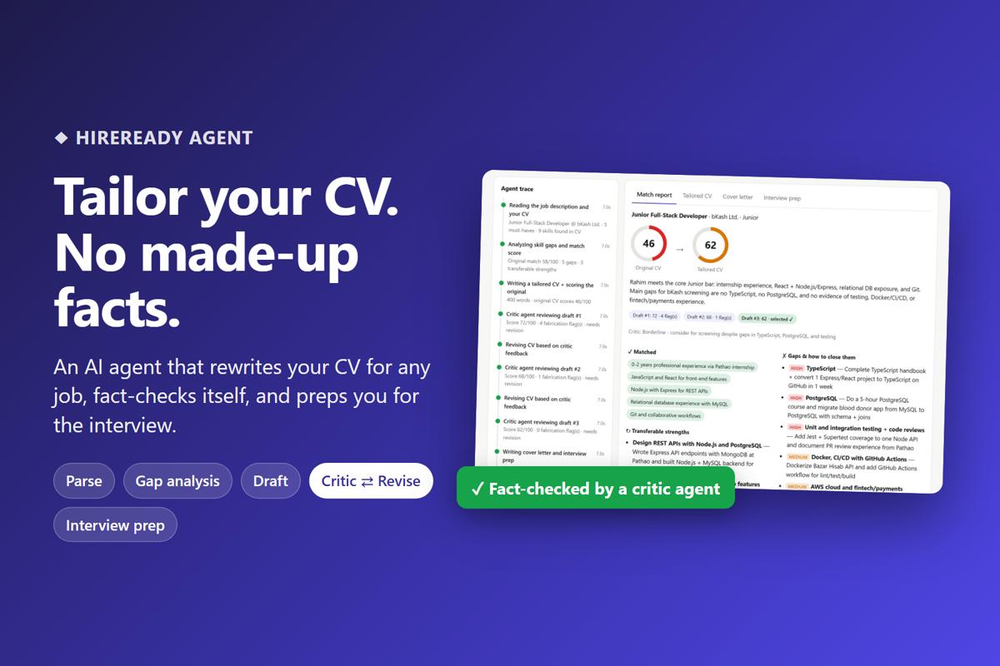
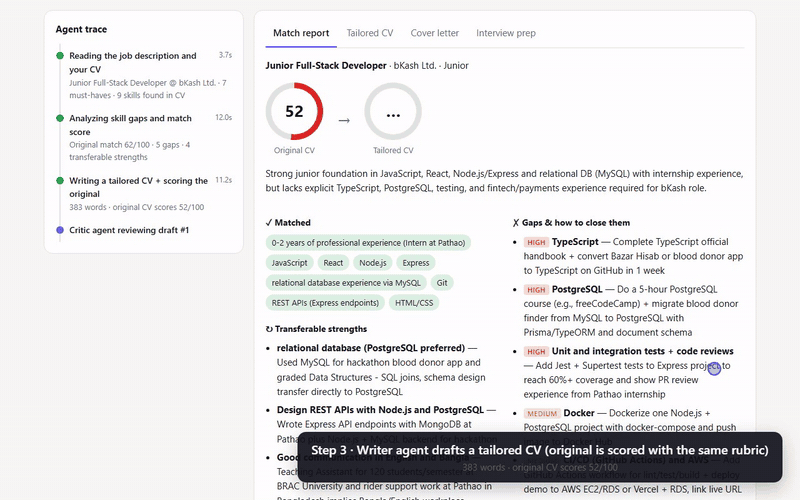
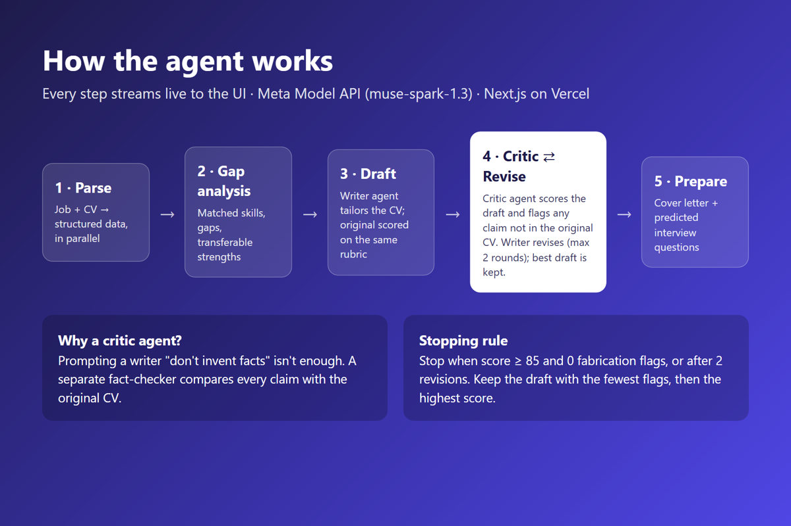
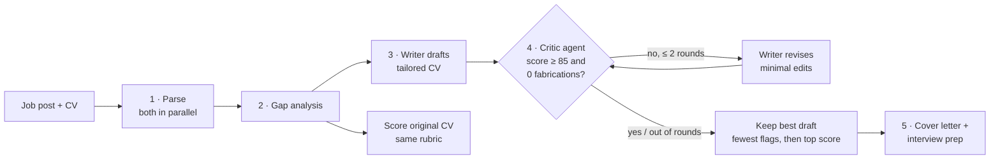
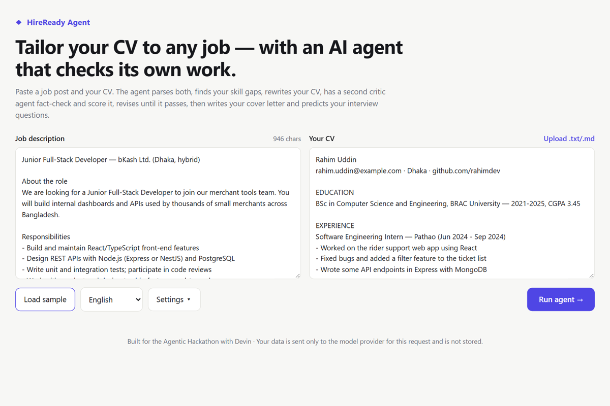
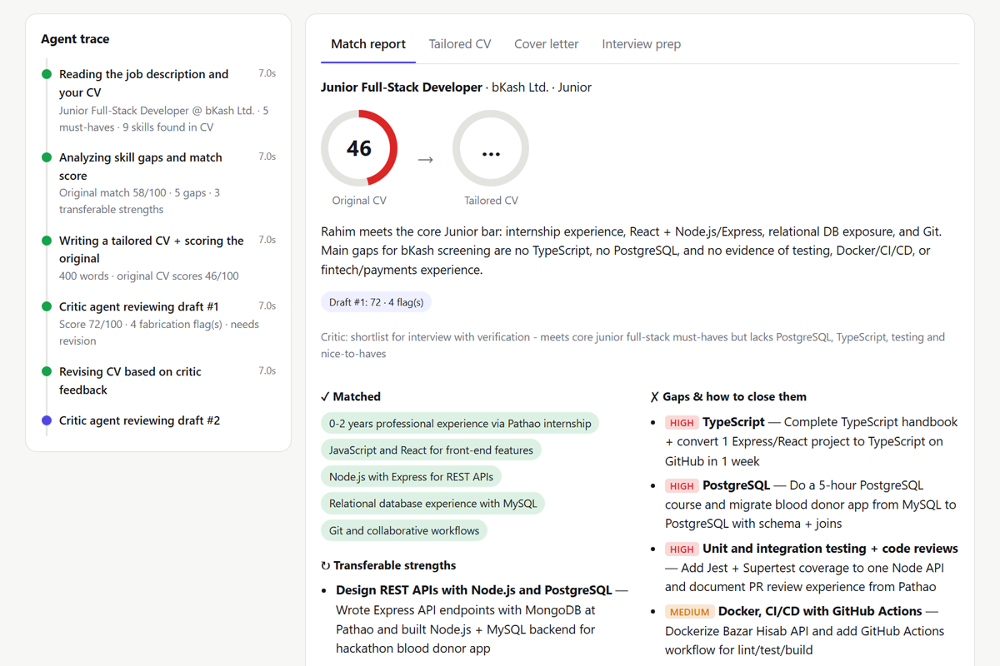
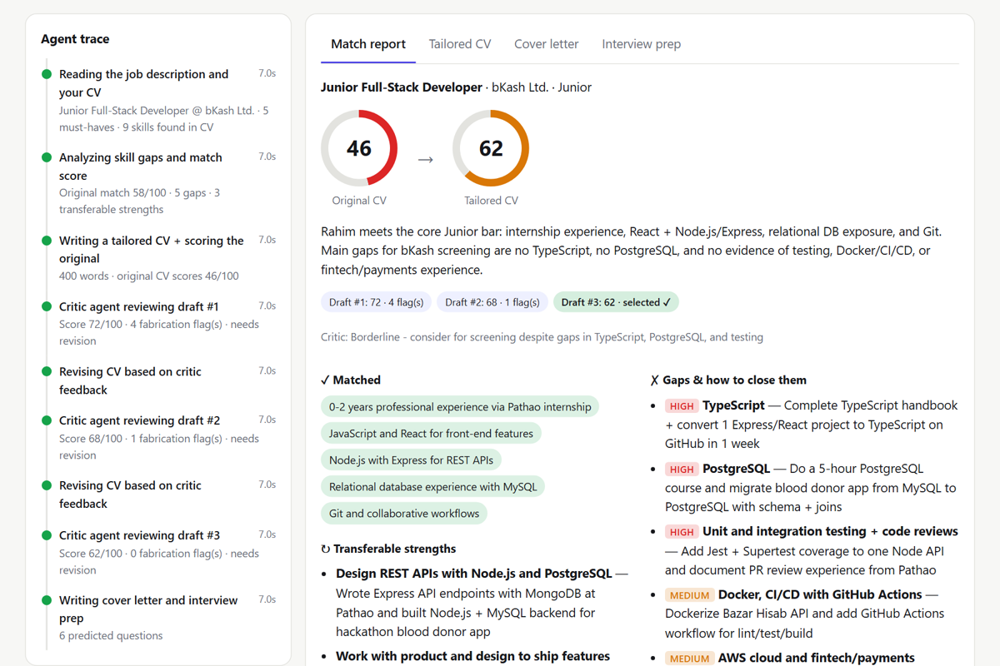
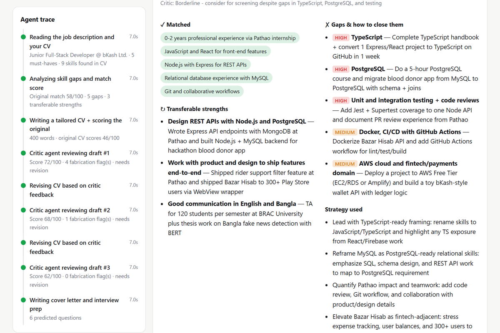
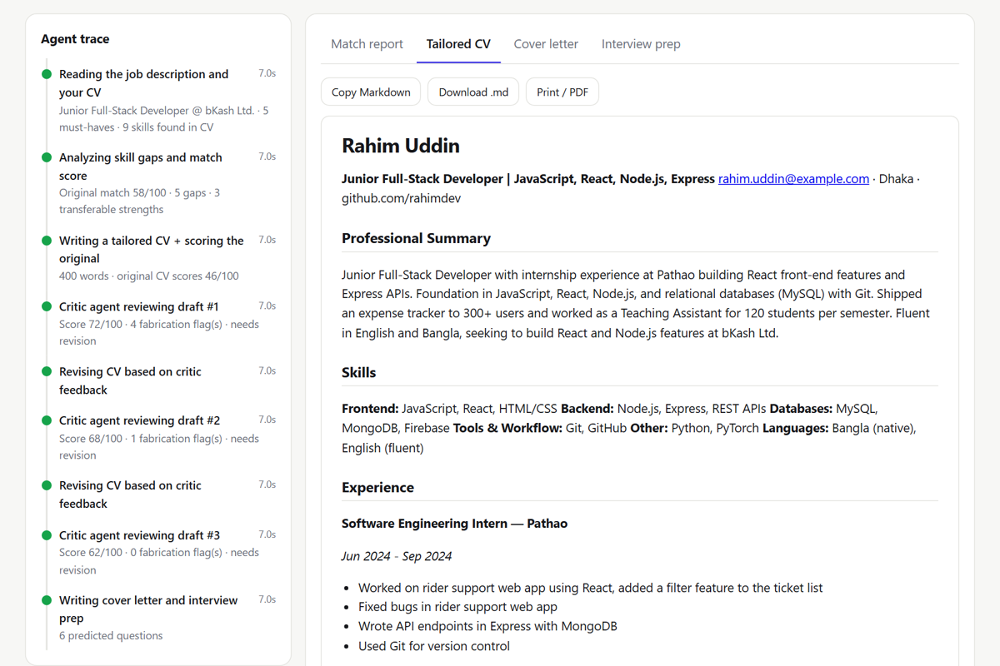
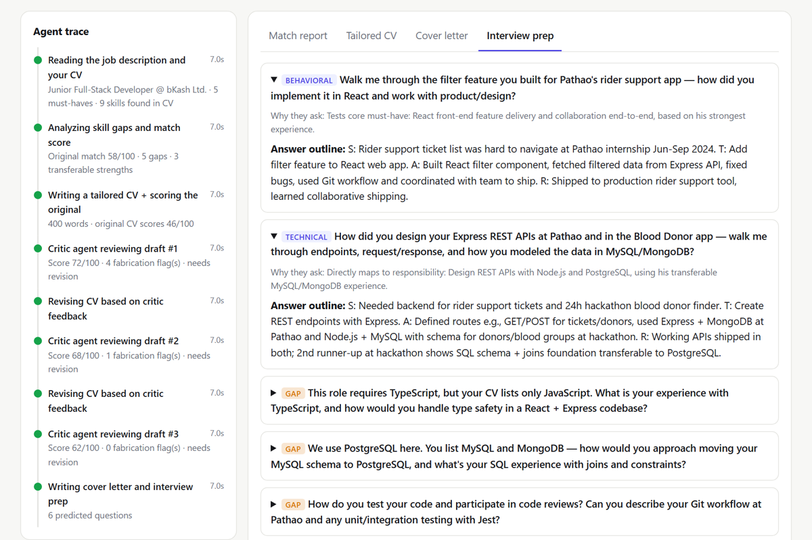

<div align="center">

# ◆ HireReady Agent

**Tailor your CV to any job, without made-up facts.**

An AI agent that rewrites your CV for a specific job, **fact-checks its own output with a second critic agent**, and gets you ready for the interview.

[**Live demo**](https://hireready-agent.vercel.app/) · [**Demo video**](https://youtu.be/LZQsHbsydGY) · [How it works](#how-it-works) · [Run locally](#run-locally)




</div>

---

## The problem

- Early-career job seekers send the **same generic CV** to every job.
- Keyword (ATS) screening rejects most of them **before a human reads them**.
- Tailoring by hand takes about an hour per job. Generic AI rewriters are fast, but they **invent skills and numbers**, and those claims fall apart in the interview.

HireReady tailors the CV in about a minute, and a separate critic agent checks every claim against your original CV.

## See it in action

<div align="center">


<sub>Live agent trace: the critic scores each draft and flags made-up claims, and the writer revises (shown at 2× speed).</sub>
</div>

📺 **Full walkthrough with voice-over:** https://youtu.be/LZQsHbsydGY

## How it works





| Step | What the agent does |
| --- | --- |
| **1. Parse** | Extracts the job's must-haves, ATS keywords and responsibilities, and turns the CV into structured data. Both run in parallel. |
| **2. Gap analysis** | Lists matched skills, real gaps with fast ways to close them, and transferable strengths the candidate didn't highlight. |
| **3. Draft** | A writer agent rewrites the CV for the role. Unknown metrics become placeholders like `[X%]` instead of invented numbers. Meanwhile, the original CV is scored with the critic's rubric, so before/after scores are comparable. |
| **4. Critic ⇄ Revise** | A separate critic agent scores the draft (keyword coverage, relevance, structure, clarity) and **flags every claim not backed by the original CV**. The writer revises until the score is at least 85 with 0 flags, or after 2 revisions. The draft with the fewest flags, then the highest score, is kept. |
| **5. Prepare** | Writes a targeted cover letter and predicts 6 interview questions, including ones that probe the gaps, each with a STAR answer outline built from real experience. |

### What the critic actually catches

These flags come from a real run on the sample CV:

| Draft | Critic's fabrication flags |
| --- | --- |
| #1 (score 72) | • *"Tools & Workflow lists 'code reviews': original CV has no mention of code reviews"*<br/>• *"'Fixed bugs and improved performance': original only says 'Fixed bugs'"*<br/>• *"'MySQL (schema design, joins)': no schema design or joins evidenced"* |
| #2 (score 68) | • *"'Designed schema and queries for donor search': original only says built a blood donor finder app (Node.js, MySQL)"* |
| #3 (score 62) | ✅ No fabrication. **This draft is selected** |

Prompting a writer with "don't invent facts" isn't enough. A dedicated fact-checker in a feedback loop is what makes the output trustworthy.

## Screenshots

| Paste a job post and a CV | Live agent trace |
| :---: | :---: |
|  |  |
| **Match report: same rubric before and after** | **Real gaps and how to close them** |
|  |  |
| **Tailored CV (copy, download, print to PDF)** | **Predicted interview questions** |
|  |  |

## Features

- 🔍 **Self-checking agent workflow**: a writer ⇄ critic loop with a clear stopping rule and best-draft selection
- 📡 **Live streaming trace**: every step, its timing and its result appear as they happen
- 📊 **Comparable before/after scores**: the original and tailored CV are scored on the same rubric
- 🧭 **Actionable gap report**: what's missing, how important it is, and how to close it quickly
- ✉️ **Cover letter and interview prep** grounded in the candidate's real experience
- 🌐 **Output in English, Vietnamese or Bangla**
- 🔒 **No database**: inputs go to the model provider for that request only and are never stored
- 🔌 **Provider-agnostic**: any OpenAI-compatible API (Meta Model API, OpenRouter, …) via env vars

## Run locally

```bash
git clone https://github.com/AIVIETNAM-AIO-felixdoit/hireready-agent.git
cd hireready-agent
npm install
cp .env.example .env.local   # add an API key (see below)
npm run dev                  # http://localhost:3000
```

Click **Load sample**, then **Run agent**. A full run takes about 1 minute.

If no server key is set, users can paste their own OpenRouter key in **Settings**. The key stays in their browser's localStorage and is only sent with their own requests.

### Environment variables

| Name | Required | Default |
| --- | --- | --- |
| `LLM_BASE_URL`, `LLM_API_KEY` | one provider is required | none (demo uses `https://api.meta.ai/v1`) |
| `LLM_MODEL` | no | `muse-spark-1.3` |
| `LLM_REASONING_EFFORT` | no | not sent (demo uses `minimal` for speed) |
| `OPENROUTER_API_KEY` | alternative to `LLM_*` | none |
| `OPENROUTER_MODEL` | no | `google/gemini-2.5-flash` |

When `LLM_BASE_URL` and `LLM_API_KEY` are set, they are used for the server key. Otherwise the app falls back to OpenRouter.

## Deploy

Import the repo in [Vercel](https://vercel.com/new) and add the env vars above. Nothing else needs configuring. The agent endpoint streams for up to about 90 seconds, well within Vercel's limit.

## Tech stack

- **Next.js 15 (App Router) + TypeScript + React 19**, deployed on Vercel
- **Meta Model API** (`muse-spark-1.3`) for every agent step, with JSON mode and a repair fallback for structured output
- **NDJSON streaming** from the API route to the browser for the live trace
- No database and no auth: stateless by design

## Project structure

```
lib/agent.ts            agent workflow: parse → gap → draft → critic/revise loop → extras
lib/llm.ts              OpenAI-compatible client: provider selection, retries, JSON repair
lib/samples.ts          sample job post and CV
app/api/agent/route.ts  streaming endpoint (NDJSON)
app/page.tsx            UI: inputs, live agent trace, results tabs
docs/images/            screenshots used in this README
```

---

<div align="center">
<sub>Built for the <a href="https://agentic-hackathon.devpost.com/">Agentic Hackathon</a>.</sub>
</div>
